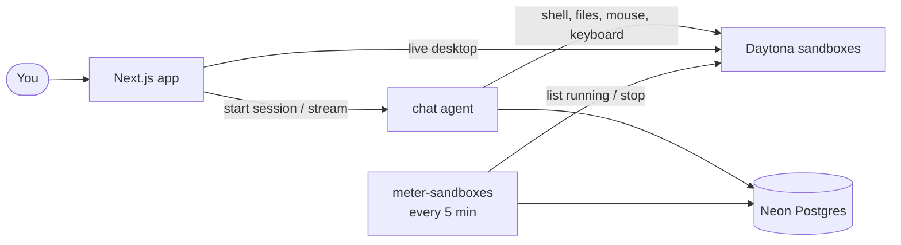

<iframe
  width="100%"
  height="315"
  src="https://www.youtube.com/embed/mQBuZ6Dp0u0"
  title="How I Build AI Teammates With Claude Code"
  allow="accelerometer; clipboard-write; encrypted-media; gyroscope; picture-in-picture; web-share"
  referrerPolicy="strict-origin-when-cross-origin"
  allowFullScreen
/>

<Note>
  This open-source project and video are by [Code With Antonio](https://github.com/code-with-antonio),
  and are featured here with their permission. The code lives in their GitHub repository.
</Note>

## Overview

Grok AI Teammates is an open-source, fullstack app where each bot has a name, a job and a persistent cloud computer of its own. A bot works in its sandbox through shell, file, mouse and keyboard tools, and you can watch its desktop live in the chat. Every chat turn runs as a durable [chat agent](/ai-chat/overview) on Trigger.dev, so a long desktop task survives page refreshes, redeploys and closed tabs.

**Tech stack:**

- **[Trigger.dev AI chat](/ai-chat/overview)** for the durable chat agent, and a [scheduled task](/tasks/scheduled) that meters running sandboxes
- **[Next.js](https://nextjs.org)** with [`useTriggerChatTransport`](/ai-chat/frontend) and the [AI SDK](https://ai-sdk.dev) `useChat` hook
- **[Daytona](https://www.daytona.io)** for one cloud sandbox per bot: a shell, a filesystem and a desktop the bot controls
- **[Clerk](https://clerk.com)** for authentication, plus Billing for plans and feature gates
- **[Neon](https://neon.com)** for serverless Postgres (with [Drizzle ORM](https://orm.drizzle.team)) and the AI gateway the model is called through
- **[Sentry](https://sentry.io)** for errors, traces and logs from the app and every task run

**Features:**

- **A computer per teammate**: each bot gets a persistent Linux sandbox. Files it leaves there are still there next time.
- **Live desktop view**: watch a bot move the mouse and type, streamed into the chat over noVNC.
- **Group chats with handoffs**: a `handoff` tool passes the rest of a turn to the teammate whose job it is. A request can't bounce back to a bot that already held it.
- **Memory across chats**: `remember` and `recall` tools read and write a notes file in the bot's sandbox, shared by every conversation the bot is in.
- **Durable turns**: the turn loop, streaming and transcript storage all run in a `chat.agent()` task on Trigger.dev.
- **Plans and usage limits**: model spend is recorded per turn in `onTurnComplete`; sandbox time is metered every 5 minutes by a scheduled task that stops sandboxes once an owner runs out.

## GitHub repo

<Card
  title="View the AI Teammates repo"
  icon="GitHub"
  href="https://github.com/code-with-antonio/ai-teammates"
>
  Click here to view the full code for this project on GitHub. It's maintained by Code With Antonio,
  and you can fork it and use it as a starting point for your own project.
</Card>

## How it works



### The chat agent

One `chat.agent()` answers every chat, direct or group. The browser sends the `botId` a message is addressed to as typed [client data](/ai-chat/server-chat), and the agent loads that bot's job and instructions from the database on every turn, so edits to a bot apply to the next message.

Tools are built per chat in the `tools` callback: every bot gets its sandbox tools, and group chats also get the `handoff` tool. Declaring them on the agent config keeps screenshot tool results as images when earlier turns are replayed. The `run` function returns the [managed `streamText`](/ai-chat/backend#the-managed-streamtext) with 2 stop conditions: a 50-step cap for desktop work, and the user's remaining model budget.

```ts trigger/chat.ts
import { chat } from "@trigger.dev/sdk/ai";
import { isStepCount } from "ai";
import { z } from "zod";

const clientDataSchema = z.object({ botId: z.string().optional() }).optional();

export const chatAgent = chat
  .withUIMessage<ChatUIMessage>()
  .withClientData({ schema: clientDataSchema })
  .agent({
    id: "chat",
    // Declared here so screenshots stay images when earlier turns are replayed
    tools: async ({ chatId, clientData }) => {
      const { chat, bots, bot } = await getChatBots(chatId, clientData?.botId);

      // Whoever holds the turn; a handoff moves it, and the sandbox tools with it
      let current = bot;
      const sandboxTools = createSandboxTools(async () => current.sandboxId);

      if (chat.kind !== "group") return sandboxTools;

      return {
        ...sandboxTools,
        ...createHandoffTool((botId) => {
          const target = bots.find((bot) => bot.id === botId);
          if (!target) throw new Error("No teammate in this chat has that id.");
          current = target;
          return { botId: target.id, name: target.name };
        }),
      };
    },
    // Fires for stopped and failed turns too, which spent tokens all the same
    onTurnComplete: async ({ chatId, runId, turn, usage }) => {
      const [row] = await db
        .select({ userId: chats.userId })
        .from(chats)
        .where(eq(chats.id, chatId));

      if (usage && row) {
        await recordUsage([
          {
            userId: row.userId,
            kind: "ai",
            amount: chatModelCost(usage),
            idempotencyKey: `ai:${runId}:${turn}`,
          },
        ]);
      }
    },
    run: async ({ chatId, clientData, messages, tools, signal, streamText }) => {
      const { chat: row, bots, bot } = await getChatBots(chatId, clientData?.botId);
      const group = row.kind === "group" ? { chat: row, bots } : undefined;

      const usage = await getUsage(row.userId);
      if (!usage || usage.remaining.ai <= 0) throw new Error(USAGE_LIMIT_ERROR);

      return streamText({
        model: chatModel(),
        system: buildInstructions(bot, group),
        messages,
        tools,
        // After a handoff, the rest of the turn uses the new bot's instructions
        prepareStep: ({ steps }) => {
          const handoff = steps
            .flatMap((step) => step.toolResults)
            .findLast((result) => result.toolName === "handoff");
          const current =
            handoff && bots.find((bot) => bot.id === (handoff.output as Handoff).botId);

          return current ? { instructions: buildInstructions(current, group) } : undefined;
        },
        stopWhen: [
          // Desktop work is one small action per step
          isStepCount(50),
          // A long turn ends once it has spent what was left
          ({ steps }) =>
            steps.reduce((cost, step) => cost + chatModelCost(step.usage), 0) >=
            usage.remaining.ai,
        ],
        abortSignal: signal,
      });
    },
  });
```

The `idempotencyKey` on each usage record is built from the run ID and turn number, so a retried `onTurnComplete` can't charge the same turn twice.

### Metering sandboxes with a scheduled task

Daytona stops idle sandboxes on its own and doesn't report running time, so the app measures it by looking. A [scheduled task](/tasks/scheduled) runs every 5 minutes, charges each running sandbox's owner for the interval, and stops the sandboxes of owners with no hours left:

```ts trigger/usage.ts
import { schedules } from "@trigger.dev/sdk";
import { inArray } from "drizzle-orm";

const INTERVAL_MINUTES = 5;

export const meterSandboxes = schedules.task({
  id: "meter-sandboxes",
  cron: `*/${INTERVAL_MINUTES} * * * *`,
  maxDuration: 240,
  run: async ({ timestamp }) => {
    const running = await listRunningSandboxIds();
    if (running.length === 0) return;

    const owned = await db
      .select({ sandboxId: bots.sandboxId, userId: bots.userId })
      .from(bots)
      .where(inArray(bots.sandboxId, running));

    await recordUsage(
      owned.map(({ sandboxId, userId }) => ({
        userId,
        kind: "sandbox" as const,
        amount: INTERVAL_MINUTES * 60,
        // A retried run meters the same moment again
        idempotencyKey: `sandbox:${sandboxId}:${timestamp.toISOString()}`,
      }))
    );

    for (const userId of new Set(owned.map((bot) => bot.userId))) {
      const usage = await getUsage(userId);
      if (usage && usage.remaining.sandbox > 0) continue;

      const sandboxIds = owned
        .filter((bot) => bot.userId === userId)
        .map((bot) => bot.sandboxId);
      await Promise.all(sandboxIds.map((id) => stopBotSandbox(id)));
    }
  },
});
```

### The Next.js chat UI

The browser talks to the agent directly through [`useTriggerChatTransport`](/ai-chat/frontend). Server actions check that the signed-in user owns the chat and has a plan with the `bots` feature before they start a session or mint a session-scoped access token. Previous messages load with [`useLoadTranscript`](/ai-chat/transcript-storage) from the agent's default transcript storage:

```tsx components/chat.tsx
import { useTriggerChatTransport, useLoadTranscript } from "@trigger.dev/sdk/chat/react";
import type { chatAgent } from "@/trigger/chat";
import { loadTranscript, mintChatAccessToken, startChatSession } from "@/actions/chat";

function Chat({ chatId, bots }: { chatId: string; bots?: ChatBot[] }) {
  const transport = useTriggerChatTransport<typeof chatAgent>({
    task: "chat",
    accessToken: ({ chatId }) => mintChatAccessToken(chatId),
    startSession: ({ chatId, clientData }) => startChatSession({ chatId, clientData }),
  });
  const { messages, isLoading } = useLoadTranscript(chatId, loadTranscript, { transport });

  // useChat only reads its initial messages on mount, so wait for the transcript
  if (isLoading) return null;

  return (
    <ChatMessages
      key={chatId}
      chatId={chatId}
      bots={bots}
      initialMessages={messages}
      transport={transport}
    />
  );
}
```

```ts actions/chat.ts
"use server";

import { auth } from "@trigger.dev/sdk";
import { chat, defaultStorage } from "@trigger.dev/sdk/ai";
import type { chatAgent } from "@/trigger/chat";

const startSession = chat.createStartSessionAction<typeof chatAgent>("chat");
const loadStoredTranscript = chat.createLoadTranscriptAction(defaultStorage);

export async function mintChatAccessToken(chatId: string) {
  await assertFeature("bots");
  await assertChatOwner(chatId);

  return auth.createPublicToken({
    scopes: { read: { sessions: chatId }, write: { sessions: chatId } },
    expirationTime: "1h",
  });
}

export async function loadTranscript(params: { chatId: string }) {
  await assertChatOwner(params.chatId);

  return loadStoredTranscript(params);
}
```

### Running it

You need accounts with Clerk, Neon, Trigger.dev and Daytona (Sentry is optional). Set the variables listed in the repo's README in `.env.local`, including `TRIGGER_SECRET_KEY` and `TRIGGER_PROJECT_REF`, then push the schema and run the app and the tasks in 2 terminals:

```bash
npm run db:push            # create the tables
npm run dev                # terminal 1: Next.js
npx trigger.dev@latest dev # terminal 2: Trigger.dev tasks
```

To deploy, run `npx trigger.dev@latest deploy` and add the tasks' variables (`DATABASE_URL`, `CLERK_SECRET_KEY`, `DAYTONA_API_KEY` and the Neon AI gateway settings) on the [Environment Variables page](/deploy-environment-variables) of your production environment. The repo's README covers the Clerk Billing setup and hosting the Next.js app.

## Relevant code

- **Chat agent**: [trigger/chat.ts](https://github.com/code-with-antonio/ai-teammates/blob/main/trigger/chat.ts): the `chat.agent()` definition, per-chat tools, handoffs, instructions, and per-turn usage recording
- **Sandbox metering**: [trigger/usage.ts](https://github.com/code-with-antonio/ai-teammates/blob/main/trigger/usage.ts): the scheduled task that charges and stops running sandboxes
- **Global hooks**: [trigger/init.ts](https://github.com/code-with-antonio/ai-teammates/blob/main/trigger/init.ts): Sentry setup with `tasks.onFailure`, `tasks.onWait` and `tasks.onComplete` hooks that flush logs before a run freezes
- **Sandbox tools**: [lib/sandbox-tools.ts](https://github.com/code-with-antonio/ai-teammates/blob/main/lib/sandbox-tools.ts): shell, file, mouse, keyboard, screenshot and memory tools on the bot's Daytona sandbox
- **Handoff tool**: [lib/handoff-tool.ts](https://github.com/code-with-antonio/ai-teammates/blob/main/lib/handoff-tool.ts): passes a group chat turn to another bot
- **Server actions**: [actions/chat.ts](https://github.com/code-with-antonio/ai-teammates/blob/main/actions/chat.ts): session start, token minting and transcript loading, each behind an ownership and plan check
- **Chat UI**: [components/chat.tsx](https://github.com/code-with-antonio/ai-teammates/blob/main/components/chat.tsx): `useTriggerChatTransport`, `useLoadTranscript` and `useChat`
- **Trigger.dev config**: [trigger.config.ts](https://github.com/code-with-antonio/ai-teammates/blob/main/trigger.config.ts): retries, max duration and the Sentry source map build extension

## Learn more

<CardGroup cols={2}>
  <Card title="AI chat overview" icon="message-bot" href="/ai-chat/overview">
    How chat agents, sessions, and the turn loop work.
  </Card>
  <Card title="Frontend" icon="browser" href="/ai-chat/frontend">
    The chat transport, session tokens, and reconnection.
  </Card>
  <Card title="Tools" icon="wrench" href="/ai-chat/tools">
    Declaring tools on your agent and how they persist across turns.
  </Card>
  <Card title="Scheduled tasks" icon="clock" href="/tasks/scheduled">
    Run tasks on a cron schedule.
  </Card>
</CardGroup>
