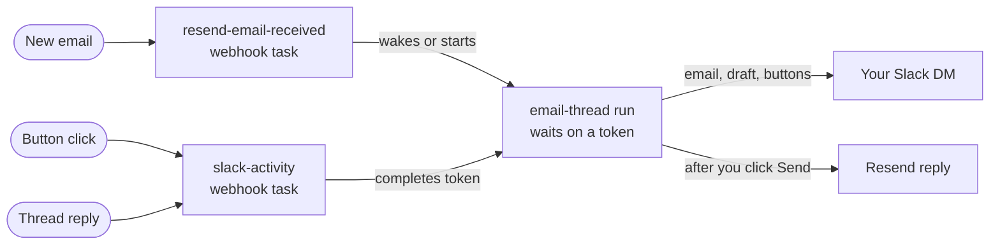

<iframe
  width="100%"
  height="315"
  src="https://www.youtube.com/embed/6GjXLwj_dnE"
  title="Resend email agent with Slack approval"
  allow="accelerometer; clipboard-write; encrypted-media; gyroscope; picture-in-picture; web-share"
  referrerPolicy="strict-origin-when-cross-origin"
  allowFullScreen
/>

## Overview

This agent drafts replies to the email in a [Resend Inboxes](https://resend.com/docs/api-reference/inboxes) inbox and posts each draft to your Slack DMs for approval. Every email chain gets its own Slack thread. Click **Send** to reply from the inbox address, **Don't send** to drop the draft, or reply in the thread ("shorter", "say we're closed over Christmas") to get a new draft. Later emails in the same chain land in the same Slack thread.

**Tech stack:**

- **[Trigger.dev webhooks](/webhooks/overview)** receive Resend and Slack events and verify their signatures
- **[Wait tokens](/wait-for-token)** pause each email thread's run until you act in Slack
- **[Resend Inboxes](https://resend.com/docs/api-reference/inboxes)** receive email and send the approved replies
- **[AI SDK](https://ai-sdk.dev)** drafts replies through the [Vercel AI Gateway](https://vercel.com/docs/ai-gateway)
- **[Slack](https://api.slack.com)** for the DM-only approval app

**Features:**

- **A person sends every reply**: the model has no tools, so a hostile email can only change the words of a draft you read first.
- **Feedback in the thread**: replying to a draft writes a new one that takes your note into account.
- **One run per email chain**: a run waits days for your click without holding a machine or a concurrency slot.
- **Sender allowlist**: `ALLOWED_SENDER_DOMAINS` drops unknown senders before they reach Slack or cost a model call.
- **Idempotent sends**: each inbound email gets at most one reply, even when a run retries.

## GitHub repo

<Card
  title="View the Resend email agent repo"
  icon="GitHub"
  href="https://github.com/triggerdotdev/examples/tree/main/resend-slack-email-agent"
>
  Click here to view the full code for this project in our examples repository on GitHub. You can
  fork it and use it as a starting point for your own project.
</Card>

## How it works

Each email chain gets one long-running `email-thread` run that sleeps on a wait token between events. The token is tagged with the email thread id and the Slack message timestamp, so a webhook from either side can find it and wake the run.



### Hosted webhook endpoints

Two endpoints receive events, one for Resend and one for Slack. Trigger.dev checks each request's signature before your code runs, and the Slack source answers Slack's `url_verification` handshake.

```ts src/trigger/endpoints.ts
import { webhooks } from "@trigger.dev/sdk";
import { webhookSource, type SlackBlockActions, type SlackMessageEvent } from "@trigger.dev/slack";
import type { ResendWebhookEvent } from "./resend";

export const resendEvents = webhooks.endpoint.define({
  id: "resend",
  source: webhooks.resend<ResendWebhookEvent>(),
});

export const slackEvents = webhooks.endpoint.define({
  id: "slack",
  source: webhookSource<SlackMessageEvent | SlackBlockActions>(),
});
```

### Waiting for approval

After posting a draft, the run creates a wait token and waits on it. The token is created before the draft is posted, so a fast click always has something to complete. Each button carries the token id.

```ts src/trigger/email-thread.ts
const token = await wait.createToken({
  timeout: "30d",
  tags: [emailTag(threadId), slackTag(slackTs)],
});
draftTs = await post(channel, "Draft reply", draftBlocks(draft, token.id), slackTs);

const result = await wait.forToken<Signal>(token);
```

### Waking the run

The webhook tasks find the waiting token by tag and complete it with what happened: a button click, a reply in the thread, or a new email. The run then sends the reply, drops it, or redrafts with your note, and waits again.

```ts src/trigger/inbound.ts
const token = await waitingToken(slackTag(msg.thread_ts));
if (token) await wait.completeToken<Signal>(token, { kind: "feedback", user: msg.user, text });
```

## Running the project

You need a Trigger.dev project, a Resend inbox on a verified domain, a Slack workspace where you can create apps, and a Vercel AI Gateway key.

<Steps>
  <Step title="Clone the example and install">
    ```bash
    git clone https://github.com/triggerdotdev/examples.git
    cd examples/resend-slack-email-agent
    cp .env.example .env
    pnpm install
    pnpm dev
    ```

    `pnpm dev` adds two endpoints, `resend` and `slack`, to your environment's **Webhooks** page.
  </Step>
  <Step title="Connect Resend">
    Add a Resend webhook pointing at the `resend` endpoint URL with the `inbox.email.received` event. Paste its signing secret into the `resend` endpoint, and set `RESEND_API_KEY`.
  </Step>
  <Step title="Connect Slack">
    Put the `slack` endpoint URL in `slack/manifest.yaml` and create the app from it. Paste its Signing Secret into the `slack` endpoint, click **Verify** in Event Subscriptions, install the app, and set `SLACK_BOT_TOKEN`.
  </Step>
  <Step title="Set who approves and who can email">
    Set `SLACK_USER_ID` to your Slack member ID, `ALLOWED_SENDER_DOMAINS` to the domains you accept email from, and `AI_GATEWAY_API_KEY`. Restart `pnpm dev`.
  </Step>
  <Step title="Send a test email">
    Email your inbox from an allowed address. A DM from the bot shows the email with a draft in its thread, and the dev terminal shows a `resend-email-received` run followed by an `email-thread` run that stays waiting.
  </Step>
</Steps>

To deploy, run `npx trigger.dev@latest deploy`, set the same environment variables on your production environment, and point Resend and Slack at the production endpoint URLs.

## Relevant code

- **Email thread task**: [src/trigger/email-thread.ts](https://github.com/triggerdotdev/examples/blob/main/resend-slack-email-agent/src/trigger/email-thread.ts): one run per chain that posts, drafts, waits on a token and acts on the result
- **Webhook tasks**: [src/trigger/inbound.ts](https://github.com/triggerdotdev/examples/blob/main/resend-slack-email-agent/src/trigger/inbound.ts): wake or start a thread's run from Resend emails, Slack clicks and thread replies
- **Drafting prompt**: [src/trigger/draft.ts](https://github.com/triggerdotdev/examples/blob/main/resend-slack-email-agent/src/trigger/draft.ts): the AI SDK call and the system prompt to tune for your inbox
- **Webhook endpoints**: [src/trigger/endpoints.ts](https://github.com/triggerdotdev/examples/blob/main/resend-slack-email-agent/src/trigger/endpoints.ts): the hosted Resend and Slack endpoints
- **Slack app**: [slack/manifest.yaml](https://github.com/triggerdotdev/examples/blob/main/resend-slack-email-agent/slack/manifest.yaml): a DM-only app with three scopes

## Learn more

<CardGroup cols={2}>
  <Card title="Webhooks" icon="webhook" href="/webhooks/overview">
    Hosted endpoints that verify and deliver events to your tasks.
  </Card>
  <Card title="Wait for token" icon="hourglass" href="/wait-for-token">
    Pause a run until an external event completes a token.
  </Card>
  <Card title="Webhook sources" icon="plug" href="/webhooks/sources">
    Every built-in source, including `resend()`, and how each is verified.
  </Card>
  <Card title="Slack" icon="slack" href="/webhooks/slack">
    The Slack source and channel in `@trigger.dev/slack`.
  </Card>
</CardGroup>
