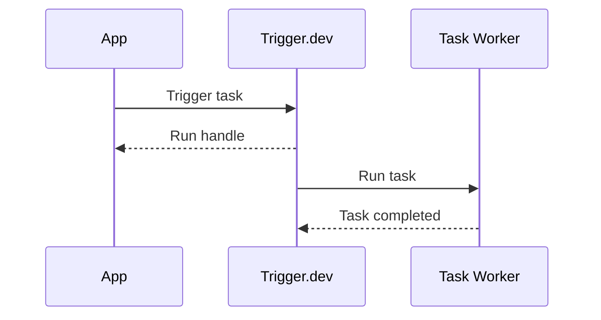
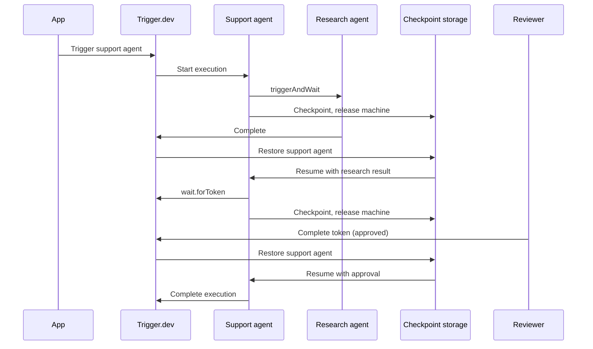
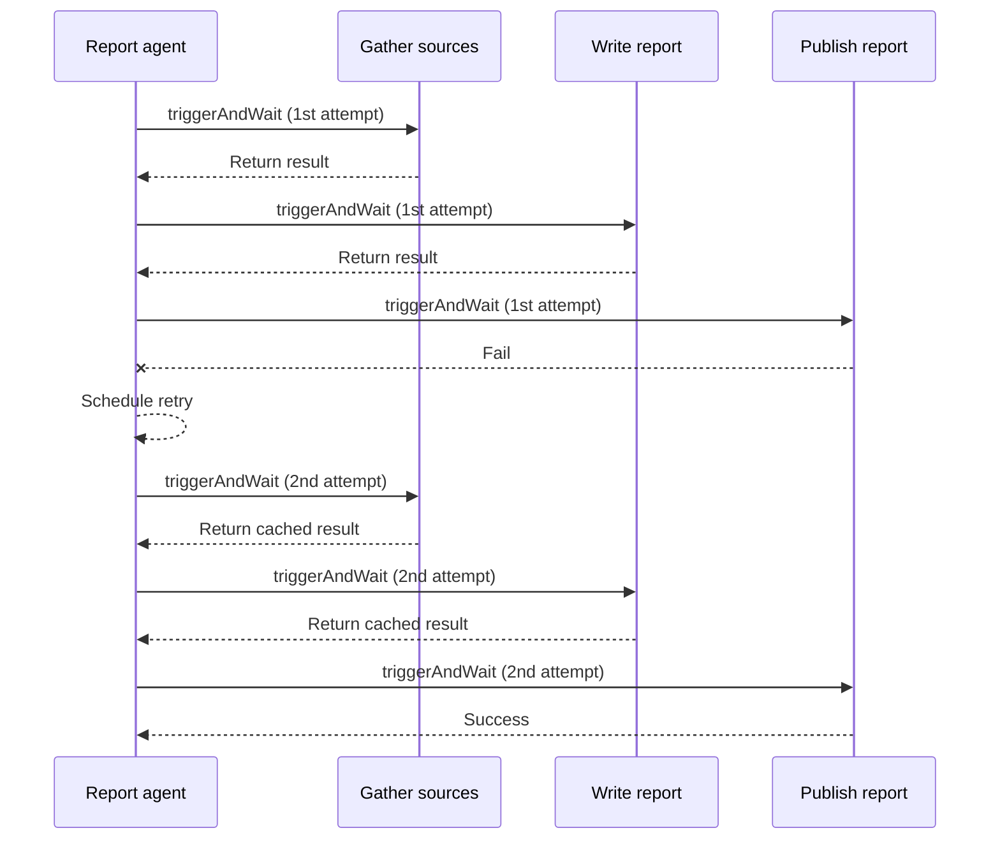

**Trigger.dev runs your AI agents as durable TypeScript tasks, with no timeouts, retries on failure, and checkpointed waits that don't burn compute.**

An agent doesn't fit inside a request. It calls a model in a loop, calls tools, hands work to sub-agents, waits on a human to approve something, and streams progress back to a user the whole time. A single run can take seconds or days. You write that loop as a normal async function, and we run it on managed compute, keep it alive across failures and deploys, and give you a trace of every step.

This page explains the machinery underneath: how a run executes, what happens when an agent waits, how retries avoid repeating finished work, and how output reaches your frontend.

## An agent as a task

A task is an async function with an `id`. This one is a research agent: it calls the model in a loop, and each tool call runs as its own task.

```typescript /trigger/research-agent.ts
import { schemaTask, task } from "@trigger.dev/sdk";
import { ai } from "@trigger.dev/sdk/ai";
import { generateText, stepCountIs, tool } from "ai";
import { anthropic } from "@ai-sdk/anthropic";
import { z } from "zod";

// Only fetch from hosts you trust, so the model can't be steered to internal services
const ALLOWED_HOSTS = new Set(["en.wikipedia.org", "developer.mozilla.org"]);

// A tool backed by a task: each call is a child run with its own retries and trace
export const fetchPage = schemaTask({
  id: "fetch-page",
  description: "Fetch a web page and return its text",
  schema: z.object({ url: z.string().url() }),
  retry: { maxAttempts: 3 },
  run: async ({ url }) => {
    const { protocol, hostname } = new URL(url);
    if (protocol !== "https:" || !ALLOWED_HOSTS.has(hostname)) {
      throw new Error(`Fetching ${hostname} is not allowed`);
    }

    const response = await fetch(url, { redirect: "error" });
    return { text: (await response.text()).slice(0, 20_000) };
  },
});

export const researchAgent = task({
  id: "research-agent",
  retry: { maxAttempts: 3 },
  run: async ({ question }: { question: string }) => {
    const { text } = await generateText({
      model: anthropic("claude-sonnet-4-5"),
      system: "You are a research agent. Fetch sources before you answer.",
      prompt: question,
      tools: {
        fetchPage: tool({
          description: fetchPage.description ?? "",
          inputSchema: fetchPage.schema!,
          execute: ai.toolExecute(fetchPage),
        }),
      },
      stopWhen: stepCountIs(20),
    });

    return { answer: text };
  },
});
```

Trigger the agent from your backend. The call returns a handle straight away, and the agent runs in the background:

```typescript Your backend code
import { tasks } from "@trigger.dev/sdk";
import type { researchAgent } from "./trigger/research-agent";
//     👆 type-only import, so your backend doesn't bundle the agent

export async function POST(request: Request) {
  const { question } = await request.json();

  const handle = await tasks.trigger<typeof researchAgent>("research-agent", { question });

  return Response.json(handle); // { id: "run_cm4f2x9...", publicAccessToken: "..." }
}
```

Use the handle's `id` to check the run's status, and pass its `publicAccessToken` to your frontend to [subscribe to the run in realtime](/realtime/overview). To show the agent's output as it's generated, write it to a stream, as in [Streaming agent output to your frontend](#streaming-agent-output-to-your-frontend).

For conversational agents where a user sends messages back and forth, use [`chat.agent`](/ai-chat/overview). It runs each conversation as a durable session on the same machinery described below.

## Architecture

When you run `npx trigger.dev@latest deploy`, we build your task code and deploy it to your Trigger.dev instance. When you trigger a task, we queue the run, then execute it in an isolated container with the [machine](/machines) size you configured. A simplified view of one run:



Behind this sit the run queue, the scheduler, the worker pool, and the logging pipeline. There is no execution timeout: a run lasts as long as your code does, up to the [`maxDuration`](/runs/max-duration) you set.

## Waiting without paying for compute

Agents spend much of their time waiting: for a sub-agent to finish, for a scheduled follow-up, or for a person to approve an action. While a run waits, we checkpoint it and free the machine, so a run can wait for days without holding a container.

This agent drafts a reply, then waits for a human to approve it before sending:

```typescript /trigger/support-agent.ts
import { task, wait } from "@trigger.dev/sdk";
import { generateText } from "ai";
import { anthropic } from "@ai-sdk/anthropic";
import { sendReply, notifyReviewer } from "../support.js";
import { researchAgent } from "./research-agent.js";

export const supportAgent = task({
  id: "support-agent",
  run: async ({ ticketId, question }: { ticketId: string; question: string }) => {
    // Hand research to a sub-agent. This run is checkpointed while it waits
    const research = await researchAgent.triggerAndWait({ question }).unwrap();

    const { text: draft } = await generateText({
      model: anthropic("claude-sonnet-4-5"),
      prompt: `Write a reply to: ${question}\n\nResearch:\n${research.answer}`,
    });

    // Pause until a reviewer approves or rejects the draft, for up to 7 days
    const token = await wait.createToken({ timeout: "7d" });
    await notifyReviewer({ ticketId, draft, tokenId: token.id });

    const approval = await wait.forToken<{ approved: boolean }>(token);

    if (approval.ok && approval.output.approved) {
      await sendReply(ticketId, draft);
    }

    return { sent: approval.ok && approval.output.approved };
  },
});
```

Your reviewer UI or backend completes the token with [`wait.completeToken()`](/wait-for-token), and the run resumes on the next line.

### The Checkpoint-Resume System

1. **Execution**: a triggered run executes in an isolated container.
2. **Wait**: the run calls `triggerAndWait`, `wait.forToken`, `wait.for`, or `wait.until`.
3. **Checkpoint**: we use CRIU (Checkpoint/Restore In Userspace) to capture the run's whole process state, including memory, CPU registers, and open file descriptors. A `wait.for()` or `wait.until()` shorter than 60 seconds doesn't checkpoint; see [Wait](/wait).
4. **Release**: the container shuts down, and the run stops using compute and concurrency.
5. **Storage**: the checkpoint is compressed and stored until it's needed.
6. **Resume**: when the sub-agent finishes, the token completes, or the wait ends, we restore the checkpoint into a new container.
7. **Continue**: the run picks up on the line after the wait, with every variable, in-flight promise, and in-memory cache as it was.



<Note>
  In the Trigger.dev Cloud we don't charge for time spent waiting on sub-agents and subtasks, or
  for checkpointed waits.
</Note>

## Retries that don't repeat finished work

Model calls are slow and cost money, so an agent shouldn't redo work it has already finished when a later step fails. Split the agent into steps that each run as a subtask, and give each step an idempotency key. When the parent retries, finished steps return their cached output instead of running again.

<CodeGroup>

```typescript /trigger/report-agent.ts
import { idempotencyKeys, task } from "@trigger.dev/sdk";
import { gatherSources, writeReport, publishReport } from "./steps.js";

export const reportAgent = task({
  id: "report-agent",
  retry: { maxAttempts: 5 },
  run: async ({ topic }: { topic: string }) => {
    // Scoped to this run, so it stays the same across retries of this run
    const idempotencyKey = await idempotencyKeys.create(topic);

    const { sources } = await gatherSources
      .triggerAndWait({ topic }, { idempotencyKey })
      .unwrap(); // Returns the output, or throws if the subtask failed

    const { report } = await writeReport
      .triggerAndWait({ topic, sources }, { idempotencyKey })
      .unwrap();

    const { url } = await publishReport
      .triggerAndWait({ report }, { idempotencyKey })
      .unwrap();

    return { url };
  },
});
```

```typescript /trigger/steps.ts
import { task } from "@trigger.dev/sdk";
import { generateText } from "ai";
import { anthropic } from "@ai-sdk/anthropic";
import { searchWeb, saveToCms } from "../services.js";

export const gatherSources = task({
  id: "gather-sources",
  run: async ({ topic }: { topic: string }) => {
    return { sources: await searchWeb(topic) };
  },
});

export const writeReport = task({
  id: "write-report",
  run: async ({ topic, sources }: { topic: string; sources: string[] }) => {
    const { text } = await generateText({
      model: anthropic("claude-sonnet-4-5"),
      prompt: `Write a report on ${topic} using these sources:\n${sources.join("\n")}`,
    });

    return { report: text };
  },
});

export const publishReport = task({
  id: "publish-report",
  run: async ({ report }: { report: string }) => {
    return { url: await saveToCms(report) };
  },
});
```

</CodeGroup>

If `publish-report` fails, the parent retries from the start, but `gather-sources` and `write-report` return their cached results, so the model isn't called again:



Read more in [Idempotency](/idempotency) and [Errors and retrying](/errors-retrying).

## Streaming agent output to your frontend

A run can stream data to your frontend or backend while it executes, such as model tokens, tool progress, or intermediate results. Define a stream, pipe into it from the task, and read it anywhere with the run ID:

```typescript /trigger/streams.ts
import { streams } from "@trigger.dev/sdk";

export const answerStream = streams.define<string>({ id: "answer" });
```

```typescript /trigger/streaming-agent.ts
import { task } from "@trigger.dev/sdk";
import { streamText } from "ai";
import { anthropic } from "@ai-sdk/anthropic";
import { answerStream } from "./streams.js";

export const streamingAgent = task({
  id: "streaming-agent",
  run: async ({ question }: { question: string }) => {
    const result = streamText({
      model: anthropic("claude-sonnet-4-5"),
      prompt: question,
    });

    // Every token is written to the stream as the model produces it
    const { waitUntilComplete } = answerStream.pipe(result.textStream);
    await waitUntilComplete();

    return { answer: await result.text };
  },
});
```

Streams resume after a dropped connection, so a page refresh picks up where it left off. In React, read a stream with `useRealtimeStream` from `@trigger.dev/react-hooks`. To send data into a running agent, such as a cancel signal or a user's answer, use [input streams](/tasks/streams#input-streams). See [Streams](/tasks/streams) and [Realtime](/realtime/overview).

## Chat agents

[`chat.agent`](/ai-chat/overview) builds on everything above for multi-turn chat. Each conversation is a durable session. A run streams a reply, waits for the next message, and is checkpointed between turns, so an idle chat uses no compute and keeps its in-memory state. If the run exits (after a deploy, a crash, or a long idle gap), the next message starts a new run that reloads the conversation history from a snapshot, but not in-memory state. The conversation survives page refreshes, deploys, and crashes, and it works with the AI SDK's `useChat`.

For the turn loop, sessions, and what survives each kind of failure, see [How the AI Agents SDK works](/ai-chat/how-it-works).

## The CLI

The CLI sets up Trigger.dev in your project, runs your agents locally, and deploys them:

```bash
npx trigger.dev@latest login # Log in to your Trigger.dev account
npx trigger.dev@latest init # Initialize Trigger.dev in your project
npx trigger.dev@latest dev # Run your tasks locally
npx trigger.dev@latest deploy # Deploy your tasks to the Trigger.dev instance
```

The CLI works with Trigger.dev Cloud and self-hosted instances. Use profiles to switch between accounts or instances:

```bash
npx trigger.dev@latest login --profile <profile> -a https://trigger.example.com # Log in to a self-hosted instance
npx trigger.dev@latest dev --profile <profile> # Run your tasks locally against that profile
npx trigger.dev@latest deploy --profile <profile> # Deploy your tasks to that instance
```

If you build with a coding agent, the [MCP server](/mcp-introduction) and [agent skills](/skills) let it write, run, and debug tasks for you.

## The build system

When you run `npx trigger.dev@latest deploy` or `npx trigger.dev@latest dev`, we build your task code with [esbuild](https://esbuild.github.io/). When deploying, the code is packaged into a Docker image and deployed to your Trigger.dev instance. In dev mode, the code is built and run on your machine.

- **Bundled by default**: code and dependencies are bundled and tree-shaken.
- **Build extensions**: use or write extensions to transform your code or the resulting Docker image, for example to add Python, Playwright, or system packages your agent's tools need.
- **ESM output**: we output ESM, which allows tree-shaking.

Run deploy with the `--dry-run` flag to review the Containerfile and build output.

Learn more in the [configuration docs](/config/config-file).

## Dev mode

When you run `npx trigger.dev@latest dev`, your task code runs locally on your machine. Scheduling still happens in the Trigger.dev instance, so waits, retries, and streams behave the same as in production.

- The same build system runs in dev mode, so your code behaves the same locally as when deployed.
- Saving a file spins up a new version automatically.
- Add debuggers and breakpoints to your code and debug it locally.
- Each run executes in a separate process, so runs execute in parallel.
- Stopping the dev server stops your local task processes. If the CLI is killed abruptly (for example by a package manager sending SIGKILL), in-flight runs are cancelled automatically. After a normal Ctrl-C stop, in-flight runs are not cancelled and can end with a `TASK_RUN_STALLED_EXECUTING` error once the 5 minute heartbeat timeout passes.

<Note>
  Trigger.dev does not support an "offline" dev mode, where tasks run without an internet
  connection. [Let us know](https://feedback.trigger.dev/) if you need it.
</Note>

## Staging and production environments

Trigger.dev supports deploying to `prod` and `staging` environments, so you can test an agent in staging before it reaches production. Deploy to a different environment with `npx trigger.dev@latest deploy --env <env>`, where `<env>` is `prod`, `staging` or `preview` (the branch is detected from git, or you can pass `--branch`). Each environment has its own API key, which you use to trigger tasks in that environment.

For more isolated environments, use [preview branches](/deployment/preview-branches) to create a separate environment for each branch of your code.

## Observability

Every run produces an OpenTelemetry trace. Subtask and sub-agent runs are linked to their parent, so one trace shows the whole agent: each model call, tool call, wait, and retry. With [AI observability](/ai/observability), each AI SDK call you opt in becomes its own span with the model, token usage, and cost.


Because traces are standard OpenTelemetry, you can add instrumentation for the libraries your agent uses. This config instruments Prisma and the AWS SDK:

```typescript trigger.config.ts
import { defineConfig } from "@trigger.dev/sdk";
import { PrismaInstrumentation } from "@prisma/instrumentation";
import { AwsInstrumentation } from "@opentelemetry/instrumentation-aws-sdk";

export default defineConfig({
  project: "<your-project-ref>",
  instrumentations: [new PrismaInstrumentation(), new AwsInstrumentation()],
});
```
