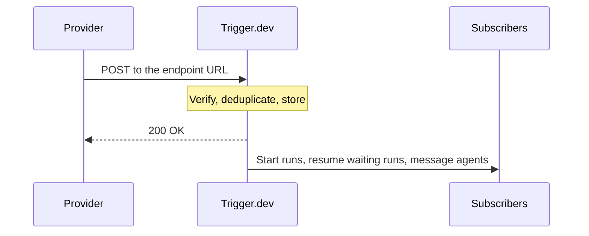

**Trigger.dev stores every webhook before it answers the provider, then routes it to the tasks, waiting runs and agents subscribed to the endpoint.**

A webhook is an HTTP request a provider such as Stripe or GitHub sends to your URL when something happens. Providers expect a fast `2xx` response and retry until they get one, so the same event can arrive more than once. A handler that does slow work before answering, or answers before saving the event, can time out, run twice or lose the event.

## What happens to a request

1. **Verify.** The endpoint checks the provider's signature or secret with the endpoint's [credential](/webhooks/signing-secrets). A request that fails is rejected and never reaches a subscriber. Provider handshakes, such as Slack's URL check, are answered here and create no delivery.
2. **Deduplicate.** A retry of an event that already arrived is answered as a duplicate. Most [built-in providers](/webhooks/providers) dedupe on the provider's event ID.
3. **Store, then answer.** The delivery is durably stored before the provider gets its `200`. Once the provider has its answer it stops retrying, and Trigger.dev is responsible for the event from then on.
4. **Route.** Each subscriber's [filter](/webhooks/filters) is checked. Matching tasks start a run, matching [waiters](/webhooks/waiters) resume their paused runs, and agent sessions receive the event as a message.

Each endpoint and environment has a rate limit. Over it, the endpoint answers `429` with `Retry-After`, so the provider sends the event again later instead of dropping it. See [Limits](/limits#webhook-ingest-rate-limits).

## Endpoints are declared in code

You declare an endpoint next to your tasks with `webhooks.endpoint.define()`. When you run `trigger dev` or deploy, the CLI sends the endpoints it finds to Trigger.dev, and the environment is synced to match: new endpoints are created, and removed ones are deactivated but keep their URL and secret, so adding one back restores it.

Each environment gets its own URL for each endpoint. Your dev environment has its own URL too, so you don't need a tunnel for local development. A delivery that arrives while `trigger dev` isn't running waits for it like any other dev run.

## One endpoint, many subscribers

A provider account usually needs one URL, so every subscriber shares the endpoint. One delivery can reach up to 25 subscribers:

| Subscriber | What a matching delivery does |
| --- | --- |
| Task, declared with `webhook()` | Starts a run with the event as its payload. |
| [Waiter](/webhooks/waiters) | Resumes a run that paused until this event arrived. |
| Agent session, via [session routing](/webhooks/session-routing) or a [channel](/webhooks/channels) | Delivers the event to the right conversation, so the agent acts with its full history. |

A delivery that no filter matches is recorded as `FILTERED` and starts no run, so it costs nothing. See [Pricing and limits](/webhooks/pricing-and-limits).

## Retries and duplicates

Duplicates are caught in two places:

- **When the webhook arrives.** A retry with the same event ID is answered as a duplicate and isn't stored again.
- **When the run starts.** Each delivery triggers its task with an [idempotency key](/idempotency) built from the endpoint and the event, kept for the provider's retry window. A retry that gets past the first check finds the existing run instead of starting a second one.

A waiter completes once, and an agent session skips an event it has already received. A resend after the retry window, such as resending an event from the provider's dashboard a week later, starts a new run, so keep side effects in your handler idempotent.

If a provider sends no event ID, the key comes from the body, timestamp and signature. See [Deduplication](/webhooks/deliveries#deduplication).

## Every delivery is recorded

Each delivery keeps its headers, body and the result for every subscriber, with links to the runs it started. A filtered delivery shows which clause failed and with what value. You can replay a delivery from the dashboard, the REST API or the MCP server. See [Deliveries and endpoints](/webhooks/deliveries).

For the design choices and infrastructure behind this, read [How we built webhooks](https://trigger.dev/blog/how-we-built-webhooks).
