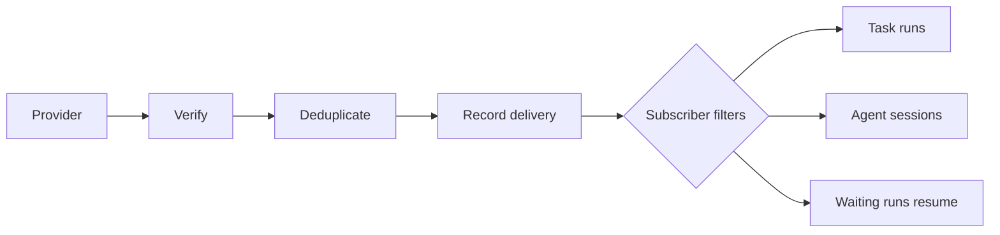

**Every request is verified and deduplicated before it is recorded, then each subscriber's filter decides whether it runs.**

The CLI finds your endpoints and subscribers during `trigger dev` and deployment, and each environment gets one endpoint per declared id. The endpoint holds the URL and the credential used to verify requests.

A request must pass verification before anything else happens. Provider handshakes are answered directly and create no delivery. A verified request is checked for duplicates, recorded, and then routed: each subscriber's filter is checked, matching subscribers run, and waiting runs whose match fits the event are resumed. The delivery records a result per subscriber.

See [Deliveries and endpoints](/webhooks/deliveries) for delivery statuses and replays, and [Filters](/webhooks/filters) for how subscribers choose events.
